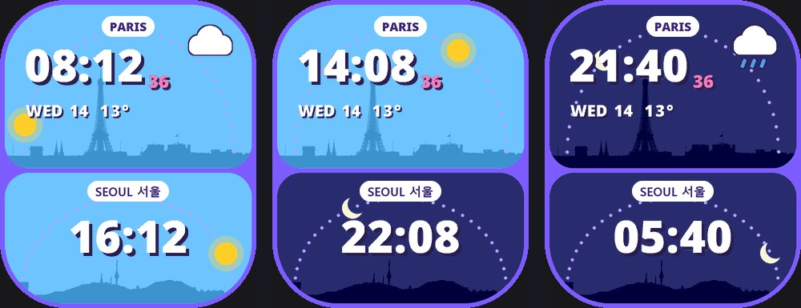

# Two Skies for the Redmi Watch 5 Active

Paris above and Seoul below, on two bright cards. Each city has its time, the colour of its sky (dawn, day, dusk or night), its skyline, and its sun or moon on a dotted arc crossing that sky through the day. Paris also has its seconds, the date, the temperature and the weather.

- [two-skies-pop.bin](two-skies-pop.bin)

To install it, see [how to install a face on this watch](../README.md).

## What to expect

- **Seoul's time:** the watch has no second time zone, so Seoul's time is drawn 8 hours ahead of the watch's own. That is right while France is on winter time, from the last Sunday of October to the last Sunday of March. A summer version will follow for the rest of the year.
- **Sunrise and sunset:** the watch does not know these times, so they are set for the winter months.
- **Hourly steps:** the sun or moon moves once an hour.
- **Weather:** the watch only has the weather for where the phone is, so only Paris shows weather.

## The skylines

Each skyline is the outline of a real photo, cut out against its sky:

- Paris, the Eiffel Tower over roofs, domes and spires: [Misty Paris](https://commons.wikimedia.org/wiki/File:Paris_Misty_Paris_%2828944235438%29.jpg) by Ali Sabbagh, CC0.
- Seoul, Namsan and N Seoul Tower from the Han River: [N Seoul Tower and Dongho Bridge](https://commons.wikimedia.org/wiki/File:N_Seoul_Tower_and_Dongho_Bridge.jpg) by Ox1997cow, public domain.
