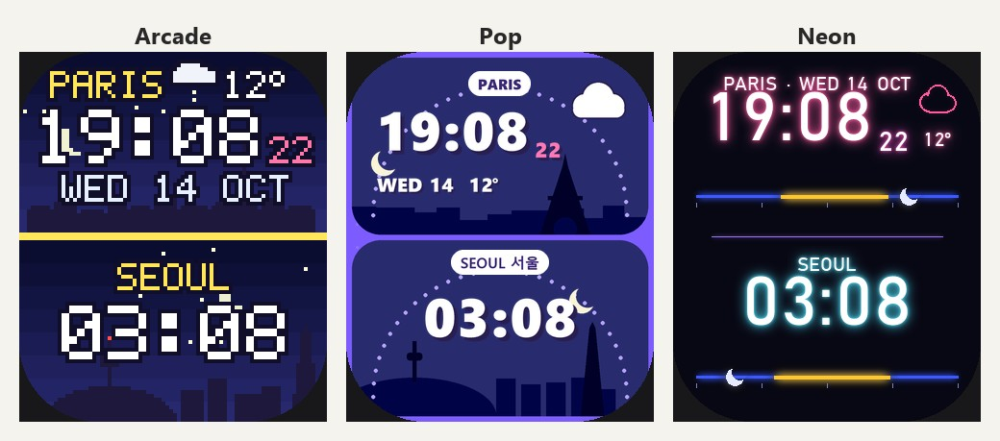

# Two Skies for the Redmi Watch 5 Active

Paris above and Seoul below. Each city has its time, the colour of its sky (dawn, day, dusk or night) and its sun or moon crossing that sky through the day. Paris also has its seconds, the date, the temperature and the weather.

Three looks, each a separate face:

- [two-skies-arcade.bin](two-skies-arcade.bin): pixel art, with the Eiffel Tower and Seoul's skyline.
- [two-skies-pop.bin](two-skies-pop.bin): two bright cards, the sun or moon on a dotted arc over each city.
- [two-skies-neon.bin](two-skies-neon.bin): each city's day as a glowing 24-hour line that its sun or moon rides along.

To install one, see [how to install a face on this watch](../README.md).

## What to expect

- **Seoul's time:** the watch has no second time zone, so Seoul's time is drawn 8 hours ahead of the watch's own. That is right while France is on winter time, from the last Sunday of October to the last Sunday of March. A summer version will follow for the rest of the year.
- **Sunrise and sunset:** the watch does not know these times, so they are set for the winter months.
- **Hourly steps:** the sun or moon moves once an hour.
- **Weather:** the watch only has the weather for where the phone is, so only Paris shows weather.
